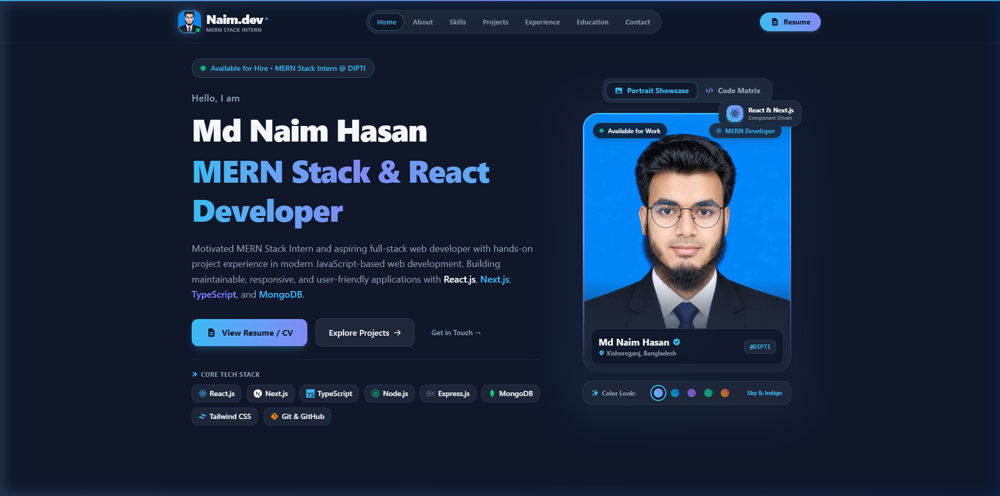

<div align="center">

  

  # Md Naim Hasan — Developer Portfolio & Interactive Showcase

  <p align="center">
    <strong>A modern, responsive, and high-performance personal portfolio built with React.js, Tailwind CSS, and Vite.</strong>
  </p>

  <p align="center">
    <a href="https://portfolio-chi-henna-74.vercel.app/" target="_blank">
      
    </a>
    
    
    
    
  </p>

  <p align="center">
    <a href="#-features">Features</a> •
    <a href="#-tech-stack">Tech Stack</a> •
    <a href="#-color-system">Color System</a> •
    <a href="#-projects-included">Projects</a> •
    <a href="#-getting-started">Getting Started</a> •
    <a href="#-contact--socials">Contact</a>
  </p>

  <br />

  

</div>

---

## 🌟 Overview

Welcome to the official source code for **Md Naim Hasan's Developer Portfolio**. Designed from the ground up to reflect a senior aesthetic with junior enthusiasm, this portfolio showcases real-world projects, technical competencies in modern frontend and MERN stack engineering, and an ATS-friendly resume viewer.

### 🔗 Live Production Deployment
- **Live URL**: [https://portfolio-chi-henna-74.vercel.app/](https://portfolio-chi-henna-74.vercel.app/)
- **GitHub Repository**: [https://github.com/mdnaimhasanofficial-glitch](https://github.com/mdnaimhasanofficial-glitch)

---

## ✨ Features

### 🎨 1. Tailored Slate Dark Theme
- Custom tailored color palette designed to harmonize with studio portrait lighting and eliminate chromatic hue bleed.
- Clean `#0F172A` background and `#1E293B` container surfaces paired with electric sky blue (`#38BDF8`) and indigo (`#818CF8`) accents.
- Interactive color mood selector allowing visitors to switch aura tones in real time.

### 🚀 2. Scrolling & Moving Object Animations
- **Real-Time Scroll Progress Indicator**: Glowing neon progress bar along the top of the viewport tracking scroll depth.
- **Ambient Moving Objects**: Subtle floating code tokens (`<Code />`, `{ }`, `const stack = "MERN"`, `Status: 200 OK`) drifting smoothly in the background with custom CSS physics.
- **Interactive Mouse Spotlight Glow**: Responsive radial ambient spotlight tracking cursor coordinates on desktop.
- **Scroll-Triggered Entrances**: `IntersectionObserver`-powered `<ScrollReveal>` wrappers that smoothly glide sections into view as you scroll.
- **Dual Floating Tech Badges**: Counter-floating micro-cards on the hero profile (`React & Next.js` and `Node & Express`).
- **Floating Back-to-Top Button**: Smoothly fades into the bottom-right corner when scrolled past 350px.

### 💼 3. Featured Projects Showcase
- **Real Screenshots & Live Links**: Fully showcased applications with high-resolution visual mockups, category tags, and tech pills.
- **Project Details Routes (`/projects/:id`)**: In-depth breakdowns containing technical challenges, solutions, and future roadmaps.
- **Direct GitHub & Live Demo Access**: Fast external action triggers on every card.

### 📄 4. ATS-Friendly Printable Resume
- Dedicated `/resume` route with a structured layout designed for recruiters and hiring managers.
- Print-optimized CSS (`@media print`) that automatically formats to standard A4/Letter size with a single click.

### 📬 5. Functional Direct-to-Gmail Contact Form
- Real-time submission powered by the Web3Forms API.
- Submissions deliver directly to `mdnaimhasan.official@gmail.com` with zero server overhead.
- Includes client-side validation, loading states, and animated success feedback toasts.

### 🔍 6. Complete SEO & Brand Assets
- Custom vector SVG favicon (`/favicon.svg`) with an electric monogram **N** and status indicator.
- Web App Manifest (`/manifest.json`) for progressive web features.
- Full OpenGraph and Twitter Card meta tags for rich social link previews.

---

## 🎨 Color System

| Token Name | Hex Code | Purpose | Preview |
| :--- | :---: | :--- | :---: |
| **Background Dark** | `#0F172A` | Page primary backdrop | `■ #0F172A` |
| **Card / Container** | `#1E293B` | Surface cards, modals, terminal | `■ #1E293B` |
| **Primary Accent** | `#38BDF8` | Buttons, active links, glow rings | `■ #38BDF8` |
| **Secondary Accent** | `#818CF8` | Secondary badges, gradient stops | `■ #818CF8` |
| **Text Main** | `#F8FAFC` | Headings, hero titles, primary text | `■ #F8FAFC` |
| **Text Muted** | `#94A3B8` | Body text, descriptions, labels | `■ #94A3B8` |

---

## 🛠️ Tech Stack

### Core Frontend
- **React 19**: Modern component architecture, functional hooks, concurrent rendering.
- **Tailwind CSS v4**: Ultra-fast utility styling with custom keyframe animations and tokens.
- **React Router DOM v7**: Client-side routing with animated transitions and dynamic params.
- **React Icons**: Feather, Heroicons, and FontAwesome SVG icon sets.

### Tooling & Build
- **Vite 8**: Lightning-fast hot module replacement (HMR) and optimized rollup production bundles.
- **Web3Forms**: Serverless form delivery directly to Gmail.
- **Oxlint**: Modern JavaScript/React linter for clean code quality.

---

## 📂 Projects Included

### 1. [FitLog — Workout Tracking Application](https://fit-log-phi-henna.vercel.app/)
- **Category**: Health & Fitness • Web Application
- **Stack**: React.js, Tailwind CSS, JavaScript (ES6+), Vercel
- **Overview**: An intuitive workout tracker helping fitness enthusiasts discover routines, track exercises, and log progress with responsive mobile-friendly layouts.

### 2. [Bazar Dor — Digital Market Price Platform](https://bazar-dor-utn4.vercel.app/)
- **Category**: Market Price & Commerce
- **Stack**: React.js, Tailwind CSS, REST APIs, Vercel
- **Overview**: A digital consumer commodity price platform designed to make daily market goods and essential pricing transparent and accessible.

### 3. [Developer Portfolio & Interactive Showcase](https://portfolio-chi-henna-74.vercel.app/)
- **Category**: Modern Portfolio & ATS Resume
- **Stack**: React.js, Tailwind CSS, Vite, React Router, Vercel
- **Overview**: High-performance personal portfolio featuring dark slate aesthetics, moving ambient particles, ATS resume printing, and direct contact integration.

---

## 📁 Project Structure

```text
frontend/
├── public/
│   ├── favicon.svg             # Custom glowing vector brand favicon
│   ├── logo.svg                # Full Naim.dev vector brand mark
│   ├── manifest.json           # Web App Manifest
│   ├── profile.jpg             # Studio portrait photo
│   └── project03.png           # High-resolution portfolio preview
├── src/
│   ├── assets/
│   │   ├── profile.jpg         # Profile image asset
│   │   └── projects/           # High-resolution project screenshots
│   │       ├── project01.png   # Bazar Dor thumbnail
│   │       ├── project02.png   # FitLog thumbnail
│   │       └── project03.png   # Portfolio thumbnail
│   ├── components/
│   │   ├── AboutMe.jsx         # Biography, training credentials, and fast facts
│   │   ├── Contact.jsx         # Web3Forms-integrated contact form
│   │   ├── Education.jsx       # Academic diplomas & training credentials
│   │   ├── Experience.jsx      # DIPTI internship & Programming Hero milestones
│   │   ├── FloatingScrollTop.jsx# Smooth floating back-to-top button
│   │   ├── Footer.jsx          # Site links, social shortcuts, copyright
│   │   ├── Hero.jsx            # Interactive hero section with mood switcher
│   │   ├── MovingBackground.jsx# Ambient drifting code particles & mouse glow
│   │   ├── Navbar.jsx          # Glassmorphic header with active indicator
│   │   ├── Projects.jsx        # Featured projects grid
│   │   ├── ScrollProgressBar.jsx # Glowing top viewport scroll tracker
│   │   ├── ScrollReveal.jsx    # IntersectionObserver scroll entrance wrapper
│   │   └── Skills.jsx          # Categorized MERN stack technical expertise
│   ├── data/
│   │   └── projects.js         # Centralized project data and metadata
│   ├── pages/
│   │   ├── Home.jsx            # Single-page portfolio assembly
│   │   ├── ProjectDetails.jsx  # In-depth single project breakdown
│   │   └── Resume.jsx          # ATS-compliant printable resume sheet
│   ├── App.jsx                 # Route management and layout wrapper
│   ├── index.css               # Design system tokens and keyframe animations
│   └── main.jsx                # Application root entry point
├── .env.example                # Environment variables template
├── index.html                  # SEO, OpenGraph tags, and favicon link
├── package.json                # Project dependencies and npm scripts
├── vite.config.js              # Vite configuration with Tailwind plugin
└── README.md                   # Comprehensive project documentation
```

---

## 🚀 Getting Started

Follow these steps to run the portfolio locally on your machine:

### 1. Prerequisites
- **Node.js**: v18.0.0 or higher
- **npm** or **yarn** / **pnpm**

### 2. Clone the Repository
```bash
git clone https://github.com/mdnaimhasanofficial-glitch/Portfolio.git
cd Portfolio/frontend
```

### 3. Install Dependencies
```bash
npm install
```

### 4. Configure Environment Variables
Create a `.env` file in the `frontend/` directory (you can copy from `.env.example`):
```bash
cp .env.example .env
```
Add your Web3Forms access key:
```env
VITE_WEB3FORMS_ACCESS_KEY=871c5739-104f-4f57-8e82-24e428133816
VITE_RECEIVER_EMAIL=mdnaimhasan.official@gmail.com
```

### 5. Run Local Development Server
```bash
npm run dev
```
Open your browser and navigate to `http://localhost:5173/`.

### 6. Build for Production
To generate a production-ready, minified bundle:
```bash
npm run build
```
To preview the production build locally:
```bash
npm run preview
```

---

## 🌐 Deployment to Vercel

The portfolio is optimized for zero-config deployment on **Vercel**:
1. Connect your GitHub repository to Vercel.
2. Set the **Root Directory** to `frontend`.
3. Set the **Build Command** to `npm run build` and **Output Directory** to `dist`.
4. Add the environment variable `VITE_WEB3FORMS_ACCESS_KEY` under Project Settings > Environment Variables.
5. Click **Deploy**!

---

## 📬 Contact & Socials

I am actively seeking junior frontend, full-stack, and MERN stack engineering opportunities. Feel free to connect:

- **Name**: Md Naim Hasan
- **Role**: MERN Stack Intern & Junior Web Developer
- **Email**: [mdnaimhasan.official@gmail.com](mailto:mdnaimhasan.official@gmail.com)
- **Phone / WhatsApp**: [+880 1616711677](tel:+8801616711677)
- **LinkedIn**: [naimhasan706016](https://www.linkedin.com/in/naimhasan706016/)
- **GitHub**: [@mdnaimhasanofficial-glitch](https://github.com/mdnaimhasanofficial-glitch)
- **Location**: Kishoreganj, Nilphamari, Bangladesh

---

<div align="center">
  <p>© 2026 Md Naim Hasan. Built with React.js & Tailwind CSS.</p>
</div>
